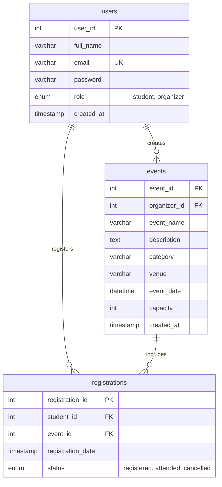

# EventEase – College Event Registration Platform
> **MCA Minor Project | Web Technologies & Database Management Systems**

EventEase is a complete, responsive, full-stack college event organization and student registration platform built strictly with **Core PHP (Procedural/Modular), MySQLi, HTML5, CSS3, JavaScript, and Bootstrap 5**.

---

## 🚀 Key Highlights & Architectural Overview

- **No Heavy Frameworks**: Hand-crafted in pure Core PHP and MySQLi, ensuring high performance, zero external bloat, and total transparency during academic presentations and viva voce.
- **Role-Based Access Control (RBAC)**: Distinct, isolated dashboards and workflows for **Students** and **Faculty Organizers**.
- **Real-Time Capacity Guard & Concurrency Safety**: Prevents overbooking auditorium/hall capacity using database transactions and row-level locking (`SELECT ... FOR UPDATE`).
- **Comprehensive Security**: Prepared statements for 100% SQL injection immunity, BCRYPT password hashing (`password_hash`), session regeneration against fixation, and CSRF protection tokens on state-changing forms.
- **Check-in & Attendance Terminal**: Real-time participant verification on campus with one-click attendance toggles and automated turnout percentage calculation.
- **Audit Reports & Export**: Detailed category breakdown, seat utilization graphs, and one-click **CSV Roster Export**.
- **Printable Digital Entry Pass**: Styled printable pass with Pass ID and verification tokens.

---

## 🛠️ Technology Stack (Strictly Implemented)

| Layer | Technology | Details |
|---|---|---|
| **Frontend** | HTML5, CSS3, JavaScript (ES6) | Responsive UI with custom Plus Jakarta Sans typography |
| **UI Framework** | Bootstrap 5.3.3 + Bootstrap Icons | Navy blue (`#0f172a`), purple accents (`#6366f1`), card lift effects |
| **Backend** | Core PHP (PHP 8.x) | Clean procedural/modular structure with reusable components |
| **Database** | MySQL / MariaDB (Port 3308 / 3306) | InnoDB engine with Foreign Keys and ON DELETE CASCADE |
| **Database Driver** | MySQLi (Prepared Statements) | Parameter binding for maximum query performance & security |
| **Server** | Apache (XAMPP) | Runs directly under `htdocs/EventEase` |
| **IDE / Version Control** | Visual Studio Code, Git & GitHub | Modular directory structure |

---

## 📂 Project Directory Structure

```text
EventEase/
│
├── assets/
│   ├── css/
│   │   └── style.css            # Custom theme (Navy & Purple SaaS styling)
│   ├── js/
│   │   └── script.js            # Live search, form validation, demo helpers
│   └── images/                  # Static assets and icons
│
├── config/
│   └── database.php             # MySQLi connection with auto-port fallback (3308/3306)
│
├── includes/
│   ├── header.php               # Common HTML head, CDNs & metadata
│   ├── navbar.php               # Dynamic, role-aware responsive navbar
│   ├── footer.php               # Professional footer with links and scripts
│   └── auth.php                 # Auth guards, CSRF tokens, flash messages, formatters
│
├── auth/
│   ├── register.php             # Student/Organizer signup with password confirmation
│   ├── login.php                # Authentication with 1-click Demo quick-fill
│   └── logout.php               # Secure session termination and cleanup
│
├── student/
│   ├── dashboard.php            # Metrics, next event highlight, recent registrations
│   ├── events.php               # Live search and category filters
│   ├── event_details.php        # Seat availability, details, and printable pass modal
│   ├── my_registrations.php     # Tabbed tracking (Active, Attended, Cancelled)
│   ├── register_event.php       # Transaction-safe event registration handler
│   ├── cancel_registration.php  # Registration cancellation & seat release
│   └── profile.php              # Name updates and secure password change
│
├── organizer/
│   ├── dashboard.php            # Organizer KPI widgets & recent signup stream
│   ├── add_event.php            # Event creation with date & capacity validation
│   ├── manage_events.php        # Event management table with quick actions
│   ├── edit_event.php           # Update event details & capacity checks
│   ├── delete_event.php         # Event deletion with cascade confirmation
│   ├── participants.php         # Student roster, status updates, and CSV export
│   ├── attendance.php           # Attendance check-in terminal with turnout metrics
│   ├── reports.php              # Quantitative category engagement and event audits
│   └── profile.php              # Organizer profile & credential settings
│
├── database/
│   └── eventease.sql            # Complete database schema and seed data
│
├── index.php                    # Public landing page with dynamic upcoming events
└── README.md                    # Project documentation & Viva preparation guide
```

---

## 🗄️ Database Design

### Database Name: `eventease`



### Table Schema Definitions:
1. **`users`**:
   - `user_id` (INT, Primary Key, Auto Increment)
   - `full_name` (VARCHAR 100, Not Null)
   - `email` (VARCHAR 100, Unique, Not Null)
   - `password` (VARCHAR 255, Hashed with BCRYPT)
   - `role` (ENUM: `'student'`, `'organizer'`, Default `'student'`)
   - `created_at` (TIMESTAMP, Default CURRENT_TIMESTAMP)

2. **`events`**:
   - `event_id` (INT, Primary Key, Auto Increment)
   - `organizer_id` (INT, Foreign Key referencing `users(user_id)` ON DELETE CASCADE)
   - `event_name` (VARCHAR 150, Not Null)
   - `description` (TEXT)
   - `category` (VARCHAR 50: Technical, Cultural, Sports, Workshop, Seminar, Academic)
   - `venue` (VARCHAR 150, Not Null)
   - `event_date` (DATETIME, Not Null)
   - `capacity` (INT, Not Null)
   - `created_at` (TIMESTAMP, Default CURRENT_TIMESTAMP)

3. **`registrations`**:
   - `registration_id` (INT, Primary Key, Auto Increment)
   - `student_id` (INT, Foreign Key referencing `users(user_id)` ON DELETE CASCADE)
   - `event_id` (INT, Foreign Key referencing `events(event_id)` ON DELETE CASCADE)
   - `registration_date` (TIMESTAMP, Default CURRENT_TIMESTAMP)
   - `status` (ENUM: `'registered'`, `'attended'`, `'cancelled'`, Default `'registered'`)
   - **Unique Constraint**: `UNIQUE KEY uq_student_event (student_id, event_id)` prevents duplicate enrollments at the database engine level.

---

## 🔑 Demo Login Credentials (Ready for Viva & Testing)

Both accounts are pre-configured in the database:

| User Role | Email Address | Password | Name |
|---|---|---|---|
| **Student** | `student@test.com` | `student123` | Test Student |
| **Organizer** | `organizer@test.com` | `organizer123` | Dr. Rajesh Sharma |

> **Pro-Tip**: The login page (`auth/login.php`) contains **1-Click Quick Demo** buttons that automatically pre-fill credentials for quick presentation during viva!

---

## ⚙️ Installation & Setup Instructions

1. **Start XAMPP**:
   - Open **XAMPP Control Panel**.
   - Start **Apache** and **MySQL**.
   *(Note: If your MySQL is configured on port 3308, `config/database.php` detects and connects automatically with fallback to 3306).*

2. **Place Files in htdocs**:
   - Ensure the repository is located inside:
     `C:\xampp\htdocs\EventEase`

3. **Import Database**:
   - Open **phpMyAdmin** (`http://localhost/phpmyadmin`) or MySQL CLI.
   - Import the script located at `C:\xampp\htdocs\EventEase\database\eventease.sql`.

4. **Launch Application**:
   - Open your browser and navigate to:
     `http://localhost/EventEase/`

---

## 🛡️ Security Mechanisms Explained

1. **Password Hashing**:
   - Uses `password_hash($password, PASSWORD_DEFAULT)` which generates strong, salted BCRYPT hashes.
   - Verification uses constant-time `password_verify($password, $hash)` to prevent timing attacks.

2. **SQL Injection Defense**:
   - Every single database interaction with user input utilizes **Prepared Statements** (`mysqli_prepare`, `mysqli_stmt_bind_param`, `mysqli_stmt_execute`). No direct variable interpolation in SQL strings.

3. **CSRF (Cross-Site Request Forgery) Tokens**:
   - State-changing forms (event creation, registration, cancellations, status changes) carry a cryptographically secure random token generated with `random_bytes(32)`.
   - Verified via `hash_equals($_SESSION['csrf_token'], $_POST['csrf_token'])`.

4. **Session Fixation Prevention**:
   - Calls `session_regenerate_id(true)` immediately upon successful user authentication.

5. **Concurrency & Capacity Integrity**:
   - In `student/register_event.php`, `mysqli_begin_transaction()` and `SELECT ... FOR UPDATE` row-level locks prevent race conditions when two students attempt to register for the final seat simultaneously.

---

## 🎓 MCA Viva Questions & Answers Reference

**Q1: Why did you choose Core PHP over a modern framework like Laravel or React?**
> *Answer*: For this project, Core PHP with modular architecture was chosen to demonstrate a deep understanding of HTTP request-response lifecycles, native session management, database transaction concurrency, and raw SQL queries without framework abstraction layers. It also ensures zero external dependency overhead and easy portability on any Apache server.

**Q2: How do you prevent event overbooking when capacity reaches 100%?**
> *Answer*: We enforce this at two layers. First, at the application layer, we wrap registration in a database transaction (`mysqli_begin_transaction`) and use `SELECT ... FOR UPDATE` to lock the event row. We query the count of existing confirmed registrations and reject the transaction if `total_booked >= capacity`. Second, the database contains a `UNIQUE KEY (student_id, event_id)` constraint that stops duplicate entries.

**Q3: How are passwords stored and verified?**
> *Answer*: Passwords are never stored in plain text. They are hashed using PHP's native `password_hash()` with the BCRYPT algorithm which incorporates an automated per-user cryptographic salt. Authentication is verified using `password_verify()` which compares hashes in constant time to thwart timing analysis attacks.

**Q4: How does the attendance tracking module function?**
> *Answer*: Organizers can view enrolled students per event and click to toggle their status between `'registered'` and `'attended'`. The system calculates live turnout percentages (`(attended / enrolled) * 100`). Students who have been marked attended immediately see an updated "Attendance Verified" badge and can print a participation certificate pass.

**Q5: What is CSRF and how did you prevent it?**
> *Answer*: Cross-Site Request Forgery occurs when an attacker tricks an authenticated browser into submitting unauthorized requests. We prevent this by generating a session-stored cryptographic token via `random_bytes(32)` rendered in a hidden form field and validating it on the server using `hash_equals()` before executing any database mutation.
